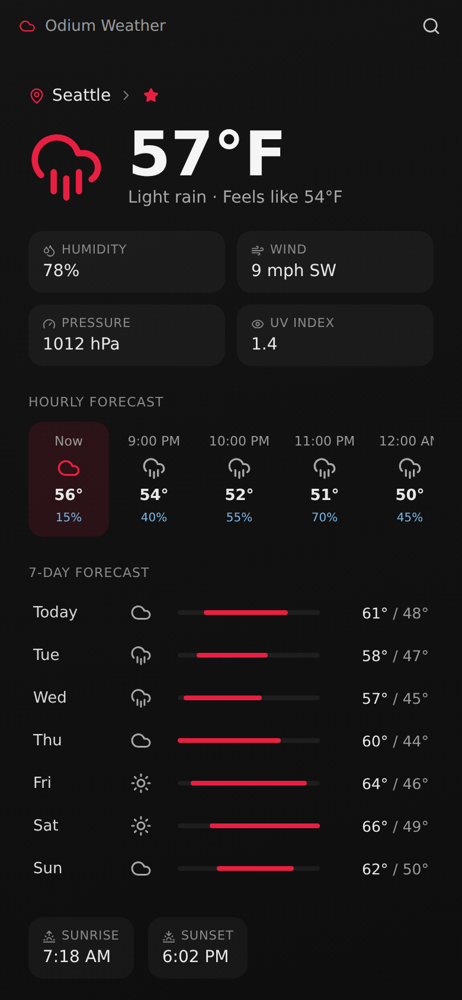
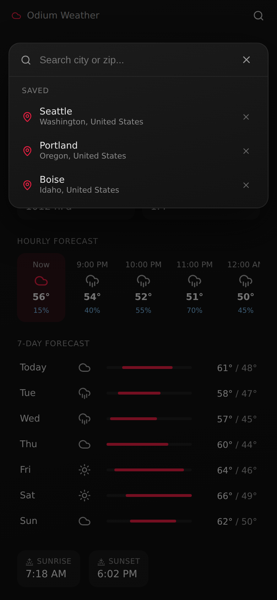

<p align="center">
  
</p>

<h1 align="center">Odium Weather for Android</h1>

<p align="center">
  A dark, minimal weather app with hourly and 7-day forecasts and a live animated radar.<br>
  Android port of the Odium Weather Electron app.
</p>

<p align="center">
  
  &nbsp;&nbsp;
  
</p>

<p align="center"><sub>Screenshots use sample data.</sub></p>

## Features

- **Current conditions**: temperature, feels-like, humidity, wind speed and direction, pressure, UV index
- **Hourly forecast**: the next 24 hours, with precipitation chance
- **7-day forecast**: daily high/low with a temperature range bar
- **Sunrise and sunset** times for today
- **Animated radar**: past and nowcast precipitation frames over a dark map, with play/pause and frame stepping
- **Location search**: search by city or zip, with results showing region and country
- **Saved locations**: tap the star next to the city name to save it, and pick from your saved list in the search panel
- **Auto-refresh**: the forecast reloads every 10 minutes
- **Remembers your last location** between launches

## How it works

The UI is the same React code as the desktop app, running inside a plain Android `WebView`. There is no backend: everything is bundled in the APK and the app talks directly to public weather APIs.

| Piece | What it does |
| --- | --- |
| `MainActivity.java` | Hosts the WebView and serves the bundled files from `assets/www` on a fake `https://appassets.androidplatform.net` origin, so `fetch()`, `localStorage` and CORS behave like a normal website. Opens external links in the system browser and handles the Back button. |
| `web-src/android-bridge.js` | Replaces Electron's preload/main-process calls. Fetches data from the APIs below and stores settings in `localStorage`. |
| `web-src/app.jsx` | The React UI (React 19, Leaflet / react-leaflet for the radar map, lucide-react for icons). |

**Data sources**

- [Open-Meteo](https://open-meteo.com/) for geocoding and forecasts
- [RainViewer](https://www.rainviewer.com/) for radar frames
- [CARTO](https://carto.com/) dark basemap tiles, with map data from [OpenStreetMap](https://www.openstreetmap.org/copyright) contributors

**Requirements:** Android 5.0 (API 21) or newer, with an internet connection. Compiled against SDK 34.

## Build the APK

1. Open this folder in Android Studio and let Gradle sync. The project uses Android Gradle Plugin 8.5.2 and Gradle 9.6.0 (via the wrapper); Android Studio's bundled JDK should be all you need.
2. **Build > Build Bundle(s) / APK(s) > Build APK(s)**
3. The APK lands at `app/build/outputs/apk/debug/app-debug.apk`

Or from the command line:

```bash
./gradlew assembleDebug
```

## Changing the UI

Edit `web-src/app.jsx`, then rebuild the web bundle:

```bash
cd web-src
npm install
npm run build
```

This bundles the app with esbuild into `app/src/main/assets/www/bundle.js` and copies `index.html` and `android-bridge.js` alongside it. Rebuild the APK afterwards to pick up the changes.

## Project layout

```
OdiumWeather/
├── app/
│   └── src/main/
│       ├── java/com/odium/weather/MainActivity.java   # WebView host
│       ├── assets/www/                                # built web bundle (generated)
│       ├── res/mipmap-*/                              # launcher icons
│       └── AndroidManifest.xml
├── web-src/
│   ├── app.jsx                                        # React UI
│   ├── android-bridge.js                              # API + settings layer
│   ├── index.html
│   └── package.json
└── docs/                                              # README images
```

## What changed vs the desktop app

- Min/Max/Close buttons are hidden (no window chrome on Android)
- The search panel fits phone width, and the title bar is touch-sized
- Hardware Back closes the search panel first, then exits the app
- Settings are saved in WebView `localStorage` instead of `~/.config`
- Hourly time labels no longer wrap

## Notes

- Units default to imperial (°F, mph, inches). The setting is stored with your preferences, but there is no in-app toggle for it yet.
- The app only requests the `INTERNET` permission. It does not use your device location; you pick a place by searching.
